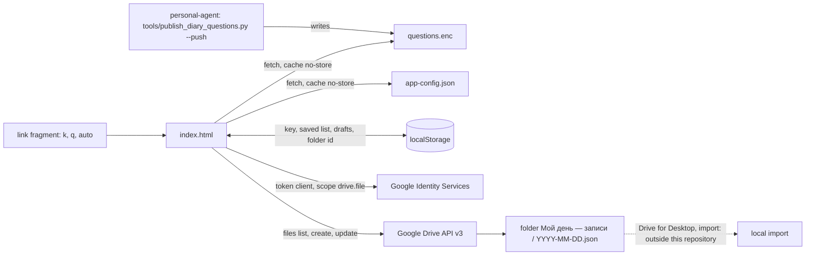

# moy-den - documentation

"Moy den" is Russian for "my day". The repository holds one static page,
`index.html`, that shows a daily questionnaire in Russian, keeps a draft of the
answers in the browser and saves each day's answers as one JSON file in the
owner's Google Drive (`README.md`). The questionnaire itself is not in the
repository in clear text: it is the encrypted file `questions.enc`, opened with a
key that arrives once in a link (`README.md`, `index.html:8-33`). The README
says it is one person's own tool and is not offered to anyone else.

The rest of the repository is the owner's lab tooling: `recipe.ps1`, git hooks,
Claude Code hooks and five Gitea workflows.

## Status

- Last commit on the documented branch, `md-61/docs/spec-md`: `9c94cf0`,
  2026-11-17 21:20 +0200, "docs(spec): add SPEC.md mirrored as Jira KAN-61"
  (`git log -1`). Its parent `38165e7`, 2026-11-07 16:47 +0200, is the tip of
  `test`: the merge of pull request #17. Pull request #18 then merged `test`
  into `release` as `952f0cf` with the same tree
  (`git diff --stat 38165e7 952f0cf`, empty), so every file of this branch
  except `SPEC.md` and this file is identical to `release`. The last change to the page files is `37fc513`, 2026-10-29,
  questionnaire v8. `index.html`, `questions.enc` and `app-config.json` are
  identical on `origin/main`, `release`, `test` and this branch
  (`git diff --stat`, empty).
- Version in `recipe.ps1:11`: `1.0.0`. Tag `v1.0.0` exists and points at
  `952f0cf` on `release`, which is not in this branch's history
  (`git merge-base --is-ancestor`).
- Automated tests: none. `python -m pytest --collect-only -q .claude` reports
  "no tests collected" with exit code 5, which `recipe.ps1:47-48` accepts.
  `.claude/pytest.ini` says the same: "None yet".
- CI: five Gitea Actions workflows in `.gitea/workflows/` on a `windows` runner.
  Whether a runner serves this repository, and whether `propose` and
  `release-gate` have run, is not recorded in the repository (`CLAUDE.md`,
  "Branch protection starts at stage 1...").
- TODO/FIXME/XXX/HACK markers: 0, counted as whole words with
  `git grep -w`, outside `questions.enc` and this file. The only whole-word
  matches are this file's own mentions of the four words. A case-insensitive
  substring search also "finds" one `xxx` inside the base64 ciphertext of
  `questions.enc`. That is a coincidence, not a marker.
- Open work: the table "Declared but not implemented" in section 3.7 of
  [`SPEC.md`](../SPEC.md). Its first four rows are the tasks proposed on
  2026-11-17 and still open in Jira KAN-61: automated tests for the page logic,
  recovery from a stale cached Drive folder, clearing an `#auto=`-only
  fragment, and English comments (R-37). `README.md` lists five
  lab-requirement exceptions: R-02 (#7), R-09 (#8), R-37 (#9), R-41 (#10),
  R-42 (#11).

## Layout

| Path | What it is |
|---|---|
| `index.html` | The whole page: markup, CSS and script inline; loads only Google's sign-in library (`index.html:176`). |
| `questions.enc` | The questionnaire, `{"v":1,"iv":...,"ct":...}`, AES-GCM, base64url (`index.html:265-285`). |
| `app-config.json` | `clientId` of the OAuth web client and a note `_` (`index.html:188`, `:644-645`). |
| `recipe.ps1` | The repository's one command interface: verbs `test`, `info`, `clean`, and `build`/`install`/`uninstall`/`run`/`publish`, which do nothing. |
| `CLAUDE.md` | The only rules file: branches, commits, gates, keys, release process. |
| `README.md` | Project overview, hosting, licence, lab compliance line. |
| `SPEC.md` | Requirements specification; its task list mirrors Jira KAN-61. |
| `docs/README.md` | This file. |
| `LICENSE` | MIT. |
| `.claude/settings.json` | Claude Code hooks and environment variables for sessions in this repository. |
| `.claude/hooks/gate.ps1` | PreToolUse gate for Bash/PowerShell calls. |
| `.claude/hooks/log.ps1`, `.claude/hooks/session-start-stop.ps1` | Event log `.claude/logs/ai.jsonl`; at SessionStart, sets `core.hooksPath`. |
| `.claude/hooks/git/` | `commit-msg` and `pre-push` hooks (sh wrappers that call PowerShell scripts). |
| `.claude/pytest.ini`, `.claude/ruff.toml` | pytest section (no tests yet); ruff pinned to `==0.16.1`. |
| `.claude/skills/lab-ai-env/SKILL.md` | A Claude Code skill that reports on the hook log and transcripts. |
| `.gitea/workflows/*.yaml` | `propose`, `release-gate`, `release`, `test`, `sweep`. |
| `.gitea/issue_template.md`, `.gitea/pull_request_template.md` | Issue and pull request templates. |
| `.gitattributes`, `.gitignore` | Line endings (LF, CRLF for `*.ps1`), Git LFS for binaries; `.claude/.env` and `.claude/logs/` are ignored. |

## Architecture

The page has no build step and no server code. Everything runs in the browser:

1. `init` (`index.html:642-697`) reads `app-config.json`. It then reads the
   address fragment (`#q=`, `#k=`, `#auto=`), loads the questionnaire from the
   fragment, from `questions.enc` or from localStorage, loads the draft of the
   current day, and renders.
2. `render`, `onToggle`, `paint` (`index.html:355-497`) draw the sections and
   keep `STATE` (`done`, `joy`, `diary`, `values`). Every change is written to
   localStorage as that day's draft (`index.html:500-510`).
3. The send button (`index.html:623-639`) gets an access token from Google
   Identity Services with scope `drive.file` (`getToken`). It then finds or
   creates the folder `Мой день — записи` (`ensureFolder`) and creates or
   overwrites `<YYYY-MM-DD>.json` through the Drive API v3 (`upload`).



The README names the writer of `questions.enc`, `tools/publish_diary_questions.py --push`
of the `personal-agent` project. The comment in `index.html:31-32` names the
consumer of the day files: Drive for Desktop, then an import that reads them
locally. Neither is in this repository. The source of `#auto=` links is named
only as "по данным часов" ("from the watch data", `index.html:687`), and the
source of the key link as "бот" ("the bot", `index.html:361`).

External services: `https://accounts.google.com/gsi/client` (`index.html:176`),
`https://www.googleapis.com/drive/v3/...` and `.../upload/drive/v3/...`
(`index.html:543`, `:555`, `:614`). Hosting: GitHub Pages serves the GitHub copy
of the repository (`README.md`).

## Build and run

The page has nothing to build or install (`README.md`, "There is no build step
and no dependency"; `recipe.ps1:16-17`). It is served by GitHub Pages at the
address given in `README.md`. The repository has no command to serve the page
locally.

Prerequisites for the repository tooling, from the project files:

| Tool | Version | Source |
|---|---|---|
| Windows PowerShell | 5.1 ("new PowerShell parses in 5.1") | `.gitea/pull_request_template.md` |
| Python with pytest | not pinned | `recipe.ps1:46`, `.claude/pytest.ini` |
| ruff | `==0.16.1` (any other version refuses to run) | `.claude/ruff.toml` |
| git; Git LFS optional | not pinned | `.claude/hooks/git/pre-push` |

Commands:

```powershell
.\recipe.ps1 test    # sets core.hooksPath, runs pytest, ruff check and ruff format over .claude (README.md, recipe.ps1:41-55)
.\recipe.ps1 info    # prints Name, Code, Version, Summary (recipe.ps1:56-62)
.\recipe.ps1 clean   # removes __pycache__, .pytest_cache, .ruff_cache (recipe.ps1:63-68)
.\recipe.ps1 build   # prints "nothing to build"; the same for install, uninstall, run, publish (recipe.ps1:69-73)
```

`CLAUDE.md` rule 3 gives the form to use from any directory and says to read the
verdict from `$LASTEXITCODE` right after the call:
`& (Join-Path (git rev-parse --show-toplevel) recipe.ps1) test`.
`recipe.ps1 test` changes the working tree: it formats in place and sets
`core.hooksPath` in `.git/config`.

Publishing a new questionnaire happens outside this repository:
`tools/publish_diary_questions.py --push` of `personal-agent` writes
`questions.enc` (`README.md`).

## Configuration

| Name | Where | Meaning | Default |
|---|---|---|---|
| `clientId` | `app-config.json` | OAuth web client ID for Google Identity Services. The README says it is not a secret. | none; missing gives "не задан clientId в app-config.json" (`index.html:518-520`) |
| `#k=<key>` | address fragment | base64url AES-GCM key for `questions.enc`; stored as `moyden.key` | none |
| `#q=<base64url JSON>` | address fragment | the whole questionnaire in the link (older route) | none |
| `#auto=<base64url JSON>` | address fragment | `{"done":[ids]}`, ticks applied to untouched items | none |
| `QUESTIONS_FILE`, `FOLDER_NAME`, `SCOPE` | `index.html:184-186` | `questions.enc`; Drive folder `Мой день — записи`; `https://www.googleapis.com/auth/drive.file` | as listed |
| `moyden.questions`, `moyden.key`, `moyden.folderId`, `moyden.draft.<YYYY-MM-DD>` | browser localStorage (`index.html:180-183`) | saved questionnaire, key, Drive folder id, per-day draft | absent |
| `.claude/.env` | gitignored file | read by `recipe.ps1:28-38`; a variable already set in the environment wins. No variable names appear in the repository. | absent |
| `PYTHONIOENCODING=utf-8`, `PYTHONUTF8=1`, `MSYS_NO_PATHCONV=1` | `.claude/settings.json` | environment of Claude Code sessions | as listed |
| `LAB_BOT_TOKEN` | Gitea secret | token used by the workflows for API calls | none; `propose` warns and skips notification without it (`.gitea/workflows/propose.yaml:167-170`) |
| `WAIT_MINUTES` | `.gitea/workflows/release-gate.yaml:101` | how long `manual-gate` waits for a verdict | `150` |
| `$Name`, `$Code`, `$Version`, `$CommitTypes`, `$CommitScopes`, `$BranchTypes`, `$Reviewers` | `recipe.ps1:9-23` | metadata and vocabulary read by hooks and workflows | as in the file |

The page has no CLI flags. `recipe.ps1` takes one verb; extra arguments go to
`$RunArgs`, which no verb uses (`recipe.ps1:5-6`).

## Usage

First opening on a device: open the key link that "the bot" sends
(`index.html:361`), of the form `<page address>#k=<key>`. The page fetches and
decrypts `questions.enc` and stores the key. It also removes the fragment from
the address (`index.html:656`, `:668-674`). Later openings need only the plain
address; the list is fetched again each time.

Filling in a day:

- Each row has a ✓ (done) and a ♥ (enjoyed) button. ♥ also sets ✓, and clearing
  ✓ clears ♥ (`index.html:476-481`).
- A `choice` section shows buttons in a row; an `hours` section shows a
  slider (default 0..16) that sends nothing until it is moved. "не отвечать"
  ("don't answer") resets it (`index.html:378-421`).
- The "Дневник дня" text field takes free text (`index.html:453-461`).
- "Отправить" saves; the status line shows `сохранено: 2026-11-18.json` for a new
  file or `перезаписано: 2026-11-18.json` for an overwrite (`index.html:631`).

Between 00:00 and 04:59 the page counts the time as the previous day
(`index.html:201-206`). To fill in a missed day, pick it in "Сутки". The page
shows "Заполняешь прошедший день" ("you are filling in a past day") and loads
that day's draft; a future date is reset to today (`index.html:211-234`).

A row whose label has a `?` mark opens its "как наслаждаться" ("how to enjoy")
protocol when tapped. "Все протоколы — список" lists all protocols by group
(`index.html:299-347`).

The header shows `<day> · опросник v<version> · отмечено N из M` (day,
questionnaire version, N of M items marked). Use it to check that a new
questionnaire version has arrived (`index.html:493-496`).

## Testing

- There are no automated tests. `recipe.ps1 test` runs pytest over `.claude`
  and accepts exit 5, "no tests collected" (`recipe.ps1:44-48`). It then runs
  `ruff check` and `ruff format` over the same folder (`recipe.ps1:49-53`).
  The page code in `index.html` is outside what pytest and ruff look at.
- CI runs the same recipe and then `git diff --exit-code`, so unformatted
  commits fail. This happens in `propose` (pull requests into `test`),
  `release-gate` (pull requests into `release`) and `test` (push to `test`,
  cron `0 3 * * *` (timezone not stated), manual dispatch).
- `release-gate` has a manual round driven by `tests/manual/tests.json`. That
  file does not exist, so the round passes as "no manual tests defined"
  (`.gitea/workflows/release-gate.yaml:111`, `:139-150`).
- Some commit messages record manual checks of the page in Chrome:
  `a84bfb3` (via playwright), `68b8e65`, `6668b58`, `a1a0597`.

## Known limitations and problems

Items marked "from code reading" were found by reading `index.html`. They were
not reproduced in a browser.

- No automated test covers any page behaviour (see Testing).
- `ensureFolder` returns the cached `moyden.folderId` without checking it, so a
  deleted or trashed folder is not recovered (`index.html:550-552`; open task
  in `SPEC.md` 3.7).
- The fragment is cleared only when it carries `q` or `k`. A link with only
  `#auto=` stays in the address and history, and reloading or reopening it on
  a later day ticks the same items in that day's draft, where they are still
  untouched (`index.html:656`, `:685-693`; open task in `SPEC.md` 3.7).
- From code reading: until a date is picked, `TARGET_DAY` stays `null` and the
  day is recomputed live by `dayKey()` (`index.html:198-199`, `:214-215`). A
  page left open across 05:00 then saves the draft and uploads the day file
  under the new day, while it still holds the answers it was filled with.
- From code reading: `esc()` is applied to texts, titles, groups and steps,
  but not to item `id`, protocol `minutes` or a section's `min`/`max`/`step`.
  These go into `innerHTML` raw (`index.html:314`, `:341`, `:389`, `:415`,
  `:433`, `:435`). A `#q=` link from anyone replaces the saved questionnaire
  (`index.html:649-652`), so a crafted link could put markup into the page.
- Drafts (`moyden.draft.<day>`) are never deleted; the script has no
  `removeItem` call. localStorage errors are swallowed when a draft is written
  (`index.html:501`) or read (`index.html:509`).
- Commit `135233c` says the OAuth client ID was taken from another site of the
  owner (learning-test) on the same origin. Under `drive.file` the two sites
  then see each other's files. `app-config.json` has not changed since that
  commit (`git log -- app-config.json`); whether the other site still uses
  the same client cannot be checked from this repository.
- The comments in `index.html` and the note in `app-config.json` are in Russian.
  The open task in `SPEC.md` 3.7 ties this to the R-37 exception named in
  `README.md`; the text of R-37 is not in this repository.
- `README.md` says "The other verbs print `nothing to <verb>`". `clean` is an
  exception: it removes cache folders and prints nothing (`recipe.ps1:63-68`).
- `README.md` says nothing pushes from the Gitea copy to GitHub. The GitHub
  copy this was written from does carry the lab history: `release`, `test`
  and `md-61/docs/spec-md`, next to `main`, which ends at `37fc513`
  (`git branch -a`).

## Related documents

- [README.md](../README.md) - overview, hosting, licence, lab compliance line.
- [SPEC.md](../SPEC.md) - the requirements specification, each requirement
  with its source in the code; its task list mirrors Jira KAN-61.
- [CLAUDE.md](../CLAUDE.md) - repository rules.
- [LICENSE](../LICENSE) - MIT.
- [.claude/skills/lab-ai-env/SKILL.md](../.claude/skills/lab-ai-env/SKILL.md) -
  the AI-environment report skill.
- [.gitea/issue_template.md](../.gitea/issue_template.md),
  [.gitea/pull_request_template.md](../.gitea/pull_request_template.md).
- The lab requirements (revision 4.0.0) are linked from `README.md` on a local
  Gitea server; they are not part of this repository.

## About this document

Written 2026-11-18 from commit `952f0cf` (branch `release`), and checked again
on 2026-11-20 against branch `md-61/docs/spec-md` at `9c94cf0`. That branch
differs from `952f0cf` only in `SPEC.md` (`git diff --stat 952f0cf 9c94cf0`),
so the line references in this file hold on both.

Commands run to check it, on 2026-11-20 unless marked:

- `git status`, `git log`, `git ls-files`, `git branch -a`, `git tag -l`,
  `git show`, `git diff --stat origin/main HEAD -- index.html questions.enc app-config.json`,
  `git diff --stat 952f0cf HEAD`,
  `git diff --stat 38165e7 952f0cf`, `git merge-base --is-ancestor v1.0.0 HEAD`
  (not an ancestor);
- `git grep -n -w -E 'TODO|FIXME|XXX|HACK' -- . ':!questions.enc'` (matches
  only in this file); `grep -o -i -E 'TODO|FIXME|XXX|HACK' questions.enc`
  (one `xxx`);
- `python -m pytest --collect-only -q -p no:cacheprovider .claude`
  ("no tests collected", exit 5);
- `.\recipe.ps1 info` (printed the four metadata lines, exit 0) and
  `.\recipe.ps1 run` (printed `nothing to run`, exit 0);
- `python -m ruff --version` (`No module named ruff` on the machine where this
  was written, on 2026-11-18 and on 2026-11-20);
- a Python one-liner that decoded the `iv` and `ct` fields of `questions.enc`
  (12-byte IV, 12638-byte ciphertext). Nothing was decrypted; no key is in the
  repository.

Not run: `.\recipe.ps1 test`, which writes `.git/config` and formats files in
place and needs ruff, absent here. Also not run: `.\recipe.ps1 clean`, the page
in a browser, Google sign-in, Drive uploads, and the Gitea workflows.
